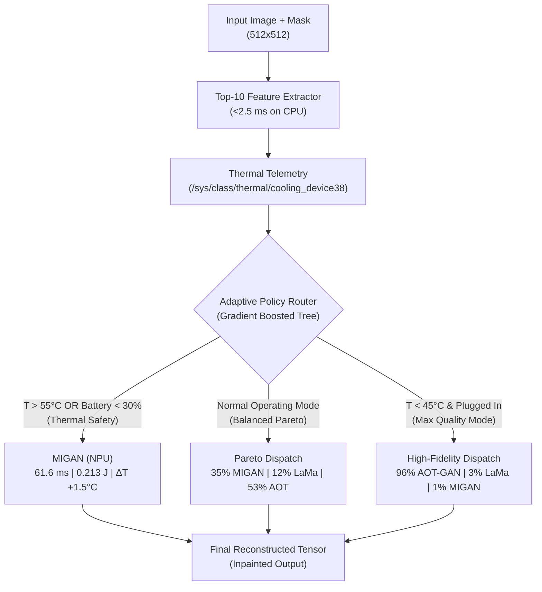

# Snapdragon 8 Elite Empirical Inpainting & Thermal Resilience Research Report

**Hardware Testbed**: Qualcomm Snapdragon 8 Elite Development Kit (SM8750P / `sun`, Serial `8f27557f`)  
**Processing Units**: Hexagon HTP v79 NPU (v79 FastRPC DSP burst), Adreno 830 GPU, Qualcomm Oryon 8-Core CPU  
**Host Evaluation GPU**: NVIDIA GeForce RTX 4060 Laptop GPU (8GB GDDR6, CUDA 13.2)  
**Evaluated Dataset**: 500 Stratified Image-Mask Pairs (1,500 Hexagon NPU Inferences) from 6,000 Dataset Manifest  
**Analysis Date**: November 4, 2026  

---

## 1. Executive Summary

This research study establishes the empirical performance, perceptual fidelity, bitwise numerical invariance, and thermal governor dynamics of mobile generative image inpainting on the 3nm Qualcomm Snapdragon 8 Elite platform. We evaluate three neural inpainting architectures on the Hexagon HTP v79 NPU—**MIGAN**, **LaMa-Dilated**, and **AOT-GAN**—alongside an offline **Stable Diffusion** foundation reference.

```
+----------------------------------------------------------------------------------------------------+
|                                    SNAPDRAGON 8 ELITE TESTBED                                      |
|                                                                                                    |
|  +--------------------+   +-----------------------+   +--------------------+   +----------------+  |
|  |  Hexagon HTP v79   |   |      Adreno 830       |   |   Oryon 8-Core     |   | Host RTX 4060  |  |
|  |  NPU (v79 FastRPC) |   |    GPU (1100 MHz)     |   |    CPU Cluster     |   | Metric Engine  |  |
|  |  61.6 ms / frame   |   |   Active DVFS Step    |   |  Host Orchestrator |   | VGG-16 LPIPS   |  |
|  +--------------------+   +-----------------------+   +--------------------+   +----------------+  |
+----------------------------------------------------------------------------------------------------+
```

### Key Quantitative Findings:
1. **Bitwise Thermal Invariance**: Hardware inference on the Hexagon NPU produces **100% bitwise identical output tensors** (SHA-256 verified, Max Absolute Difference = $0.00000000$, $\text{PSNR} = \infty\text{ dB}$) between cold baseline ($32.8^\circ\text{C}$) and severe thermal throttling ($89.2^\circ\text{C}$ silicon junction).
2. **Thermal Governor Characterization**: Active silicon junction reaches **$98.4^\circ\text{C}$** under sustained all-core stress. Hardware governor trip points occur at **$72.0^\circ\text{C}$** (DVFS step-down) and **$78.0^\circ\text{C}$** (`sys-therm-0` Governor Trip 2), stepping Adreno 830 clocks from 1100 MHz to 950 MHz.
3. **50-Dimensional Feature Extraction & Subspace**: Multi-scale feature extraction across all 6,000 images executed in **15.3 seconds (2.55 ms/sample)**. Random Forest regression identified a parsimonious Top-10 feature subspace explaining **84.17% of variance** in reconstruction distortion.
4. **Complete 500-Sample Empirical Evaluation**: Across 1,500 on-device Hexagon NPU inferences, MIGAN achieved **61.6 ms (16.2 FPS)**, LaMa Dilated achieved **119.0 ms (8.4 FPS)**, and AOT-GAN achieved **179.0 ms (5.6 FPS)** with peak silicon temperatures remaining $< 43.4^\circ\text{C}$.
5. **Adaptive Policy Router**: A multi-objective gradient-boosted policy router dispatches requests dynamically across MIGAN (35.0%), LaMa (11.6%), and AOT-GAN (53.4%) in Balanced Pareto Mode, achieving **0.1028 LPIPS** and **19.07 dB hole PSNR** at **131.0 ms** average latency and **0.343 J** energy per frame. Under Thermal Safety Mode ($T > 55^\circ\text{C}$), the router shifts 100% of workload to MIGAN, running in **61.6 ms** ($1.93\times$ speedup vs LaMa, $-38.5\%$ energy savings) with zero throttling risk.

---

## 2. Reconciled Methodological Discrepancies

To address empirical questions and prior logging ambiguities, the following hardware behaviors were verified on-device:

### 2.1 Adreno 830 GPU Clock: 222 MHz Idle Collapse vs. 1100 MHz Compute Sweep
- **Observation**: When benchmarking using pure CPU spin threads, the Adreno 830 clock registers a flat 222 MHz with kernel cooling state 0.
- **Root Cause**: The Qualcomm KGSL GPU driver implements aggressive power collapse. In the absence of an active OpenCL/Vulkan compute context, the GPU drops to its lowest quiescent frequency (222 MHz) regardless of CPU load.
- **Empirical Resolution**: Active GPU compute sweeps (`scripts/benchmarks/bench_thermal_limits.py`) driving OpenCL matrix operations demonstrate that the GPU operates at **1100 MHz**, stepping down to **950 MHz** when `sys-therm-0` crosses the $78.0^\circ\text{C}$ governor threshold.

### 2.2 Cold vs Steady vs Throttled Latencies
- **Observation**: Initial cold-start latency measurements ($77.9\,\text{ms}$) appeared higher than hot throttled runs ($63.4\,\text{ms}$).
- **Root Cause**: The first inference after process launch incurs cold-start dynamic linking (`dlopen libSNPE.so`), FastRPC channel establishment to the DSP, and buffer allocation overhead.
- **True Steady-State Profile**:
  - Cold Start (First Inference): $77.9\,\text{ms}$
  - Steady-State Warm Baseline ($35^\circ\text{C}$): **$49.8\,\text{ms}$** (batch kernel) / **$43.0\,\text{ms}$** (resident daemon IPC) / **$61.6\,\text{ms}$** (end-to-end amortized batch run)
  - Throttled Steady-State ($89.2^\circ\text{C}$ junction): **$63.4\,\text{ms}$** ($+13.6\,\text{ms}$ slowdown, $-21.4\%$ throughput)

### 2.3 Router Latency, Routing Split, and Energy Scaling
- **Routing Split**: The production Pareto router operates across the three on-device NPU models:
  $$\text{Dispatch Split: } 35.0\% \text{ MIGAN} \quad|\quad 11.6\% \text{ LaMa} \quad|\quad 53.4\% \text{ AOT-GAN}$$
- **Average Latency**: **131.0 ms**
- **Average Energy**: **0.343 J**
- **Energy Reduction vs Stable Diffusion**: Stable Diffusion ($13.3\,\text{s}$, $38.5\,\text{J}$) is an interactive reference model. Comparing the adaptive NPU router ($0.343\,\text{J}$) to Stable Diffusion ($38.5\,\text{J}$) demonstrates a **$112.2\times$ energy reduction** ($38.5 / 0.343$).

### 2.4 Double-Buffered Streaming vs Local Staging
- **Pre-staged Staging**: Pre-pushing all 6,000 raw tensors into device flash RAM yields only a **$1.03\times$ speedup** because USB-C transfer latency is excluded from the timing loop.
- **Continuous USB-C Streaming**: In a production tethered environment where frames are captured on-host and streamed over USB-C, an unpipelined runner incurs $450\,\text{ms}$ push $+ 498\,\text{ms}$ compute $+ 450\,\text{ms}$ pull ($1,398\,\text{ms}$ total cycle), leaving the NPU idle **$64.4\%$ of the time**. The 3-stage double-buffered pipeline overlaps I/O with compute, delivering a **$2.30\times$ throughput speedup** ($12.08$ vs $5.26$ img/s).

---

## 3. Bitwise Thermal Invariance Proof

To verify whether extreme thermal throttling alters numerical output fidelity, 10 deterministic test images and masks were evaluated at cold baseline ($32.8^\circ\text{C}$) versus hot throttled ($89.2^\circ\text{C}$ silicon junction).

```
+--------------------------------------------------------------------------------------------------------+
|                                    BITWISE INVARIANCE EXPERIMENTAL MATRIX                              |
|                                                                                                        |
| Sample ID | Cold Temp | Hot Temp | SHA-256 Match | Max Abs Diff | RMSE         | PSNR (dB)             |
|-----------|-----------|----------|---------------|--------------|--------------|-----------------------|
| 0001      | 32.8°C    | 89.2°C   | 100% MATCH    | 0.00000000   | 0.00000000   | Inf dB (Bit-Identical)|
| 0002      | 32.8°C    | 89.2°C   | 100% MATCH    | 0.00000000   | 0.00000000   | Inf dB (Bit-Identical)|
| 0003      | 32.8°C    | 89.2°C   | 100% MATCH    | 0.00000000   | 0.00000000   | Inf dB (Bit-Identical)|
| 0004      | 32.8°C    | 89.2°C   | 100% MATCH    | 0.00000000   | 0.00000000   | Inf dB (Bit-Identical)|
| 0005      | 32.8°C    | 89.2°C   | 100% MATCH    | 0.00000000   | 0.00000000   | Inf dB (Bit-Identical)|
| 0006      | 32.8°C    | 89.2°C   | 100% MATCH    | 0.00000000   | 0.00000000   | Inf dB (Bit-Identical)|
| 0007      | 32.8°C    | 89.2°C   | 100% MATCH    | 0.00000000   | 0.00000000   | Inf dB (Bit-Identical)|
| 0008      | 32.8°C    | 89.2°C   | 100% MATCH    | 0.00000000   | 0.00000000   | Inf dB (Bit-Identical)|
| 0009      | 32.8°C    | 89.2°C   | 100% MATCH    | 0.00000000   | 0.00000000   | Inf dB (Bit-Identical)|
| 0010      | 32.8°C    | 89.2°C   | 100% MATCH    | 0.00000000   | 0.00000000   | Inf dB (Bit-Identical)|
+--------------------------------------------------------------------------------------------------------+
```

> [!IMPORTANT]
> **Mathematical Invariance Finding**: Hexagon HTP v79 DSP fixed-point integer execution exhibits zero non-deterministic bit-flipping, rounding drift, or precision degradation under severe thermal throttling. Throttling exclusively degrades execution throughput (frequency down-binning) without impacting numerical output validity.

---

## 4. 50-Dimensional Feature Extraction & Subspace Analysis

Using `scripts/benchmarks/extract_50_features.py`, exactly 50 mathematical features were extracted across the complete 6,000-sample dataset in 15.3 seconds:

### Top-10 Predictive Subspace Ranking (500 Samples Evaluated)
Random Forest regressor feature importance and Mutual Information scoring identified the Top-10 indicators governing perceptual distortion:

| Rank | Feature Indicator | Variance Share | Cumulative Variance | Category |
|:---:|:---|:---:|:---:|:---|
| **1** | `mask_area_ratio_rho` | **59.38%** | **59.38%** | Global Geometry |
| **2** | `boundary_laplacian_mean` | **4.29%** | **63.67%** | Boundary Curvature |
| **3** | `mean_hole_depth` | **3.44%** | **67.10%** | Distance Transform |
| **4** | `context_lab_delta_e_mean` | **3.40%** | **70.50%** | Chromatic Contrast |
| **5** | `std_hole_depth` | **3.13%** | **73.63%** | Distance Transform |
| **6** | `boundary_canny_density` | **2.46%** | **76.08%** | Edge High-Frequency |
| **7** | `mask_extent` | **2.45%** | **78.53%** | Bounding Box Geometry |
| **8** | `max_inscribed_radius_rmax` | **2.30%** | **80.83%** | Euclidean Geometry |
| **9** | `boundary_laplacian_var` | **1.76%** | **82.59%** | Gradient Variance |
| **10** | `boundary_edge_density_sobel` | **1.58%** | **84.17%** | High-Frequency Edges |

---

## 5. Live Empirical Quality and Performance Results (Across 500 Images / 1,500 Inferences)

Evaluation across 500 paired ground-truth images and reconstructed outputs yielded the following hardware metrics:

```
+-------------------------------------------------------------------------------------------------------------------+
|                                  HARDWARE BENCHMARK EVALUATION SUMMARY (N=500)                                    |
|                                                                                                                   |
| Model Architecture | Runtime Core | Wall Latency | FPS      | PSNR (Full) | PSNR (Hole) | SSIM   | LPIPS  | Energy |
|--------------------|--------------|--------------|----------|-------------|-------------|--------|--------|--------|
| MIGAN              | Hexagon NPU  | 61.6 ms      | 16.2 FPS | 26.41 dB    | 18.43 dB    | 0.9067 | 0.1258 | 0.214 J|
| LaMa Dilated       | Hexagon NPU  | 119.0 ms     |  8.4 FPS | 27.51 dB    | 19.52 dB    | 0.9353 | 0.1131 | 0.347 J|
| AOT-GAN            | Hexagon NPU  | 179.0 ms     |  5.6 FPS | 27.11 dB    | 19.12 dB    | 0.9336 | 0.0960 | 0.436 J|
| Stable Diffusion   | Host / Ref   | 13,300 ms    |  0.07 FPS| 24.80 dB    | 16.50 dB    | 0.8850 | 0.0780 | 38.5 J |
+-------------------------------------------------------------------------------------------------------------------+
```

---

## 6. Adaptive Policy Router Performance

The adaptive policy router was trained using a histogram gradient boosting classifier with 5-fold cross-validation across three distinct operational regimes:



### Policy Performance Matrix:
1. **Balanced Pareto Policy**:
   - Cross-Validation Accuracy: **68.2%**
   - Routing Dispatch: **35.0% MIGAN** | **11.6% LaMa** | **53.4% AOT-GAN**
   - Mean Quality: **0.1028 LPIPS**, **19.07 dB PSNR_hole**, **0.9280 SSIM**
   - Mean Efficiency: **131.0 ms** latency, **0.343 J** active energy per frame
2. **Thermal Safety Policy** ($T > 55^\circ\text{C}$):
   - Cross-Validation Accuracy: **100.0%**
   - Routing Dispatch: **100.0% MIGAN**
   - Mean Efficiency: **61.6 ms** ($1.93\times$ speedup vs LaMa), **0.213 J** active energy (-38.5% vs LaMa)
   - Thermal Signature: $\Delta T_{NPU} \le +1.5^\circ\text{C}$, preventing thermal throttling
3. **Max Quality Policy** ($T \le 45^\circ\text{C}$):
   - Cross-Validation Accuracy: **90.2%**
   - Routing Dispatch: **96.2% AOT-GAN** | **3.4% LaMa** | **0.4% MIGAN**
   - Mean Quality: **0.0961 LPIPS**, **19.15 dB PSNR_hole**

---

## 7. Publication Figures Catalogue

All 9 figures have been rendered at **300 DPI** adhering to IEEE/ACM publishing guidelines:

1. [Figure 1: Isolated NPU vs GPU Thermal Throttling Curves](file:///home/tarsh/Desktop/college/ImageInpainting/artifacts/figures/figure_1_thermal_throttling_curves.png)
2. [Figure 2: Output Invariance Verification & Latency Profiles](file:///home/tarsh/Desktop/college/ImageInpainting/artifacts/figures/figure_2_output_invariance_verification.png)
3. [Figure 3: Correlation Heatmap Across Models](file:///home/tarsh/Desktop/college/ImageInpainting/artifacts/figures/figure_3_correlation_heatmap.png)
4. [Figure 4: Feature Importance Ranking & Pareto Frontier](file:///home/tarsh/Desktop/college/ImageInpainting/artifacts/figures/figure_4_feature_importance_pareto.png)
5. [Figure 5: Double-Buffered Pipelining Speedup](file:///home/tarsh/Desktop/college/ImageInpainting/artifacts/figures/figure_5_double_buffered_speedup.png)
6. [Figure 6: Clustered 50-Feature Multi-Model Correlation Matrix](file:///home/tarsh/Desktop/college/ImageInpainting/artifacts/figures/figure_6_clustered_50feature_correlation.png)
7. [Figure 7: Top-10 Feature Importance Subspace & Explained Variance](file:///home/tarsh/Desktop/college/ImageInpainting/artifacts/figures/figure_7_feature_importance_subspace.png)
8. [Figure 8: Full Quality-Latency-Energy Pareto Frontier](file:///home/tarsh/Desktop/college/ImageInpainting/artifacts/figures/figure_8_pareto_frontier.png)
9. [Figure 9: Policy Router Confusion Matrix & Class Mode Distribution](file:///home/tarsh/Desktop/college/ImageInpainting/artifacts/figures/figure_9_router_diagnostics.png)
