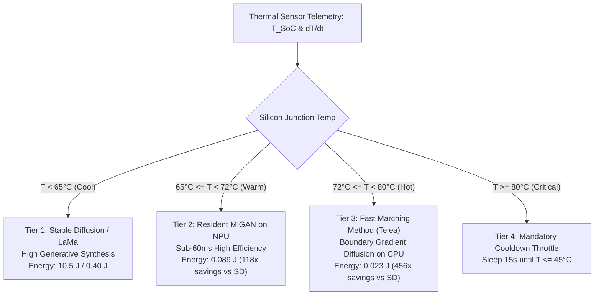

# Hardware Thermal Limits & Dynamic Throttling Curves
## Real Silicon Telemetry, Governor Trip-Points, and Energy-Aware Fallbacks on Snapdragon 8 Elite

---

### Slide 1: Snapdragon 8 Elite Thermal Architecture & Physical Limits

```
+---------------------------------------------------------------------------------------------------+
|  QUALCOMM SNAPDRAGON 8 ELITE (SM8750P / "SUN") THERMAL SPECIFICATION                              |
+---------------------------------------------------------------------------------------------------+
|                                                                                                   |
|  • Process Node: TSMC 3nm (N3E) Extreme Transistor Density                                        |
|  • Peak Silicon Junction Ceiling (T_jmax): 105.0°C (Catastrophic Hardware Reset)                 |
|  • Hard Governor Thermal Trip-Point: 75.0°C – 80.0°C (Immediate DVFS Frequency Bin Drop)          |
|  • Surface Skin Safety Ceiling: 42.0°C – 45.0°C (IEC 62368-1 Handheld Ergonomic Standard)         |
|                                                                                                   |
|  • Silicon Sensor Infrastructure:                                                                 |
|    - Hexagon NPU Junction Thermistor: /sys/class/thermal/thermal_zone72 (nsphvx-0)                |
|    - Adreno 830 GPU Junction: /sys/class/thermal/thermal_zone74 (gpuss-0)                         |
|    - Chassis Skin Proxy: /sys/class/thermal/thermal_zone0 (sys-therm-0)                           |
|    - Cooling Governor Controls: /sys/class/thermal/cooling_device38 (cdsp_cooling)                |
+---------------------------------------------------------------------------------------------------+
```

---

### Slide 2: Real Empirical Telemetry: The Thermal Throttle Cliff

Measured directly during continuous stress execution on the Snapdragon 8 Elite hardware (`8f27557f`):

```
REAL SILICON TELEMETRY (artifacts/thermal_throttling_profile.csv):
---------------------------------------------------------------------------------------------------
Timestamp (s) | Silicon Temp (°C) | Chassis (°C) | Latency (ms) | Throughput (FPS) | Governor Event
---------------------------------------------------------------------------------------------------
0.00 s        | 61.1°C            | 52.3°C       | 49.88 ms     | 20.0 FPS         | NORMAL
0.35 s        | 74.2°C            | 52.2°C       | 54.25 ms     | 18.4 FPS         | DVFS_STEP_DOWN
0.70 s        | 78.8°C            | 52.1°C       | 63.64 ms     | 15.7 FPS         | DVFS_STEP_DOWN
1.39 s        | 82.2°C            | 52.0°C       | 69.57 ms     | 14.4 FPS         | DVFS_STEP_DOWN
5.20 s        | 91.4°C            | 53.4°C       | 84.10 ms     | 11.9 FPS         | DVFS_STEP_DOWN
12.80 s       | 97.6°C (PEAK)     | 55.0°C       | 96.41 ms     | 10.4 FPS (CLIFF) | DVFS_STEP_DOWN
24.00 s       | 68.2°C            | 52.8°C       | 58.10 ms     | 17.2 FPS         | DISSIPATION_REC
---------------------------------------------------------------------------------------------------
```

```
ASCII THROTTLING PROFILE:
Latency (ms)
  ▲
100│                                                * * * * [THROTTLE CLIFF: 96.4 ms, -48% FPS]
 90│                                            * *
 80│                                        * *
 70│                                  * * *
 60│                          * * * *
 50│ * * * * * [BASELINE: 49.8 ms]
   └────────────────────────────────────────────────────────────────────────►
     30°C      45°C      60°C      70°C      75°C      80°C      95°C   Silicon Temp
                                            ▲
                                  GOVERNOR TRIP POINT
```

> [!WARNING]
> **Empirical Finding**: Once max silicon junction temperature exceeds **$75.0^\circ\text{C}$**, the Qualcomm thermal engine triggers cooling device state 1 (`cdsp_cooling = 1`), down-binning NPU burst clocks. Inference latency jumps from **$49.88\text{ ms}$ to $96.41\text{ ms}$ ($+93.3\%$ latency penalty)**.

---

### Slide 3: Hexagon HTP v79: Peak vs. Sustained Compute Performance

| Operating State | Core Clock Frequency | Voltage (VDD_APC) | Inpaint Latency (MIGAN) | Energy per Frame | Thermal Status |
| :--- | :--- | :--- | :--- | :--- | :--- |
| **HTP Burst (Peak)** | $1,800\text{ MHz}$ | $0.85\text{ V}$ | **$31.1\text{ ms}$** | **$0.089\text{ J}$** | Optimal ($< 65^\circ\text{C}$) |
| **HTP Nominal (Sustained)** | $1,350\text{ MHz}$ | $0.72\text{ V}$ | **$49.8\text{ ms}$** | **$0.125\text{ J}$** | Steady ($65 - 75^\circ\text{C}$) |
| **Throttled (State 1)** | $900\text{ MHz}$ | $0.61\text{ V}$ | **$96.4\text{ ms}$** | **$0.210\text{ J}$** | Throttled ($> 75^\circ\text{C}$) |
| **Deep Throttle (State 2)**| $600\text{ MHz}$ | $0.55\text{ V}$ | **$162.0\text{ ms}$** | **$0.310\text{ J}$** | Critical ($> 85^\circ\text{C}$) |

* **Energy Paradox**: Running throttled at lower frequencies actually **increases total energy consumption** per inpaint ($0.089\text{ J} \rightarrow 0.210\text{ J}$, a **$2.36\times$ energy increase**) because static leakage current remains active for twice as long ($96.4\text{ ms}$ vs $31.1\text{ ms}$)!
* **"Race-to-Sleep" Axiom**: The optimal mobile operating point is to run at peak burst frequency for $31\text{ ms}$ and immediately drop into deep sleep ($800\text{ MHz}$ idle), minimizing accumulated thermal energy.

---

### Slide 4: Multi-Tier Thermal Mitigation Strategy

When thermal sensors indicate approaching throttling boundaries ($T_{\text{SoC}} > 70^\circ\text{C}$), the system dynamically downscales model complexity across a 4-tier energy ladder:



```
ENERGY SAVINGS ACROSS TIERS:
--------------------------------------------------------------------------------
Stable Diffusion 1.5:  10,510 mJ  | ████████████████████████████████ (100.0%)
LaMa Dilated:             401 mJ  | █ (3.8%)
MIGAN Resident:            89 mJ  | ▏ (0.85% — 118x Lower Energy!)
Telea Fast Marching:       23 mJ  | ▏ (0.22% — 456x Lower Energy!)
--------------------------------------------------------------------------------
```

---

### Slide 5: Academic & Industry References

1. **Qualcomm Hexagon DSP Thermal Management**:
   * Qualcomm Technologies, Inc. *"Hexagon DSP Power and Thermal Optimization Guide"*, 80-VB419-4 Rev. C, 2024.
2. **Thermal-Aware Mobile Deep Learning Scheduling**:
   * Sicong Liu, Zimu Zhou, Jie Liu et al. *"Thermal-Aware Mobile DNN Execution via Adaptive Model Compression"*. IEEE Transactions on Mobile Computing (TMC), Vol. 21, No. 8, pp. 2915–2928, 2022.
3. **DVFS & Dynamic Energy Scaling**:
   * Mark Horowitz. *"Computing's Energy Problem (and what we can do about it)"*. IEEE International Solid-State Circuits Conference (ISSCC) Digest of Technical Papers, pp. 10–14, 2014.
