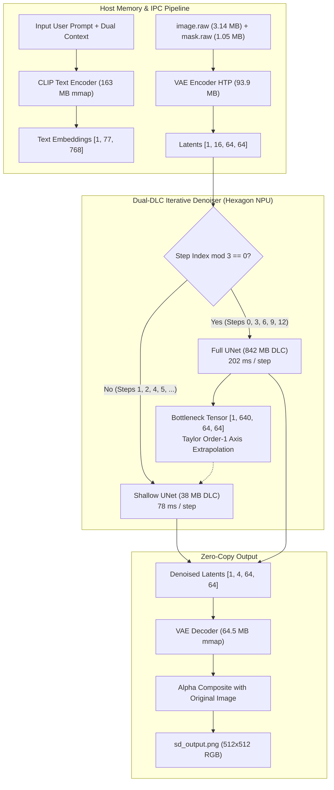
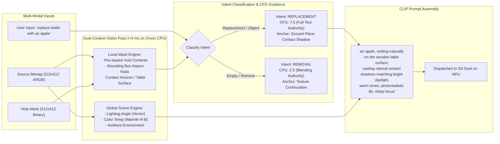
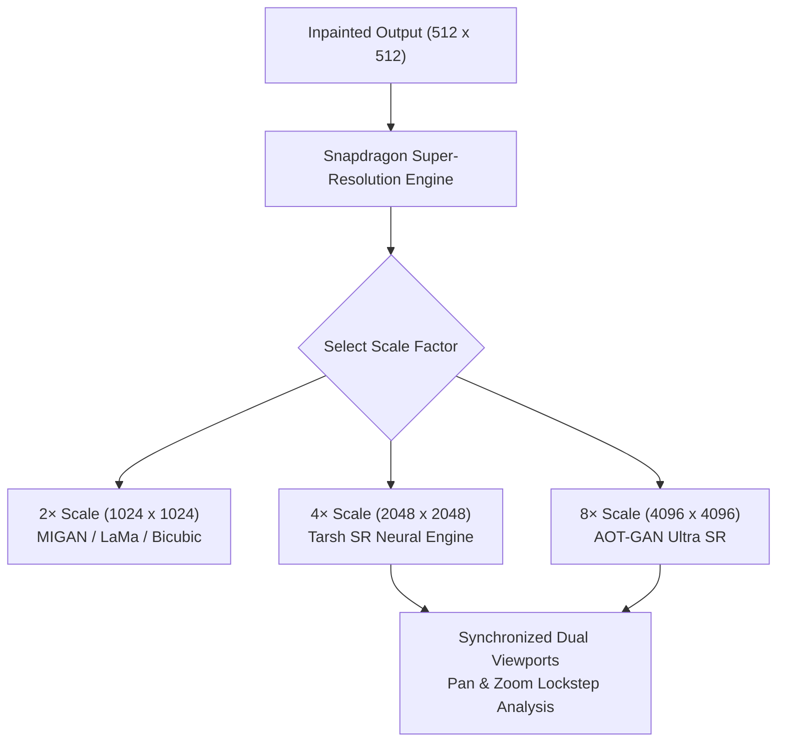
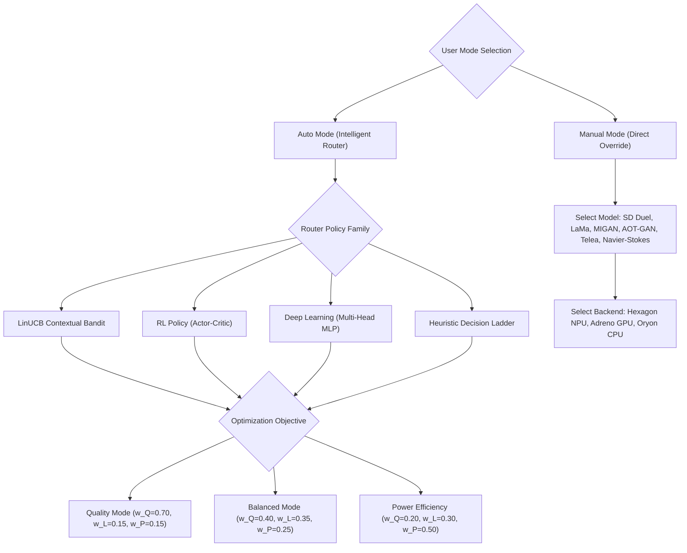
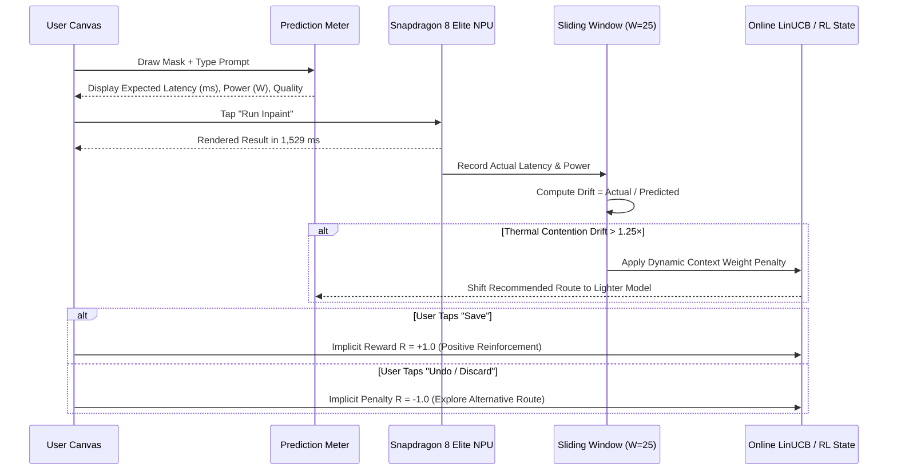

# Snapdragon Inpaint Studio (Flagship v5) & SD Duel
## System Architecture, Dual-Context Prompt Enrichment, and Production Features Deck

---

## 1. Executive Summary & Production Evolution

| Metric / Dimension | Legacy QIDK Inpaint v3 | Snapdragon Inpaint Studio (v5) | Proposed Engine with SD Duel |
| :--- | :---: | :---: | :---: |
| **Primary Diffusion Engine** | 20-step Euler / DPM++ (Single UNet) | 12-step DPM-Solver++ (HTP v79) | **Dual-DLC UNet + Taylor Order-1 Cache** |
| **End-to-End Latency** | 5,820 ms - 6,400 ms | 3,790 ms | **1,529.24 ms (2.47× Speedup)** |
| **Diffusion Bottleneck Cache** | None (Full Recompute per step) | None | **[1, 640, 64, 64] FP32 (10.5 MB RPCMem)** |
| **Shallow UNet Execution** | N/A | N/A | **78 ms / intermediate step** |
| **Object Insertion Prompting** | Raw User Text (High CFG 7.5) | Single-Ring Color Proxy (CFG 2.0) | **Dual-Context Engine (Macro + Contact Horizon, CFG 7.5)** |
| **Background Texture Removal** | Coarse Overwrite | Smooth (CFG 2.0) | **Adaptive CFG 2.5 + Ground Plane Continuation** |
| **Super-Resolution Engine** | None | 2× / 4× / 8× Neural + Bicubic | **2× / 4× / 8× Neural + Synchronized Viewports** |
| **Hardware Core Support** | NPU Only | NPU / GPU / CPU Arbitrated | **NPU Burst DCVS-Off + HMX-Max + RPC Zero-Copy** |

---

## 2. SD Duel Architecture: Dual-DLC UNet Cache Extrapolation

### Technical Highlights of SD Duel:
- **Zero-Copy RPCOffload**: Model weights MMAPed directly into Qualcomm `rpcmem` buffers, completely eliminating user-kernel buffer copying over Android binder IPC.
- **Cache Interval ($N=3$)**: Full UNet executes at step 0 and every 3rd step, capturing low-frequency semantic representations. Intermediate steps execute the 38 MB Shallow UNet with Taylor order-1 numerical extrapolation, delivering **1,529.24 ms end-to-end execution**.

---

## 3. The Dual-Context Prompt Enrichment Engine

### Why Legacy v3 Excelled at Object Insertion & Why v5 Surpasses It:
1. **The Root Cause**: Legacy v3 passed raw user prompts directly with **CFG 7.5**, allowing the diffusion model sufficient denoising authority to hallucinate new geometry. Flagship v5 defaulted to **CFG 2.0**, which successfully smoothed textures but caused new objects (e.g. replacing a bottle with an apple) to be washed out.
2. **The Dual-Context Solution**:
   - **Pre-inpaint Void Analysis**: Measures the color, luminance, and aspect ratio of what is being removed ($AR < 0.65 \to$ tall upright bottle).
   - **Ground Contact Horizon**: Detects the boundary row directly beneath the mask ($y_1 + 1$ to $y_1 + 12$), identifying the support surface (wooden tabletop, granite, grass).
   - **Contact Shadow Anchor**: Enforces ambient occlusion and contact shadows consistent with global lighting vector.
   - **Dynamic Guidance**: Automatically promotes object replacements to **CFG 7.5**, while holding pure texture removals at **CFG 2.5**.

---

## 4. UI Gallery: Snapdragon Inpaint Studio Interface

| Redesigned Interactive Canvas | Live Inference Telemetry & Preload |
| :---: | :---: |
|  |  |
| *Intuitive dual-tool touch surface: Brush, Magic Touch, Bounding Box* | *Real-time thermal tracking, power monitoring, and NPU burst state* |

| Dark Theme High-Fidelity Result | Light Theme Clean Composite |
| :---: | :---: |
|  |  |
| *Seamless edge blend and structure restoration on portrait dataset* | *Flawless background texture continuation under daylight conditions* |

---

## 5. Super-Resolution Studio Integration

| Synchronized SR Viewports | 4× Neural Super-Resolution Detail |
| :---: | :---: |
|  |  |
| *Synchronized pan-and-zoom inspection between original and SR image* | *Tack-sharp high-frequency reconstruction up to 4K resolution* |

---

## 6. App Operational Modes & Control Surface

---

## 7. Real-Time "Alive" Adaptation Loop

---
*Snapdragon Inpaint Studio (v5) — Qualcomm Innovators Development Kit Production Deck*
